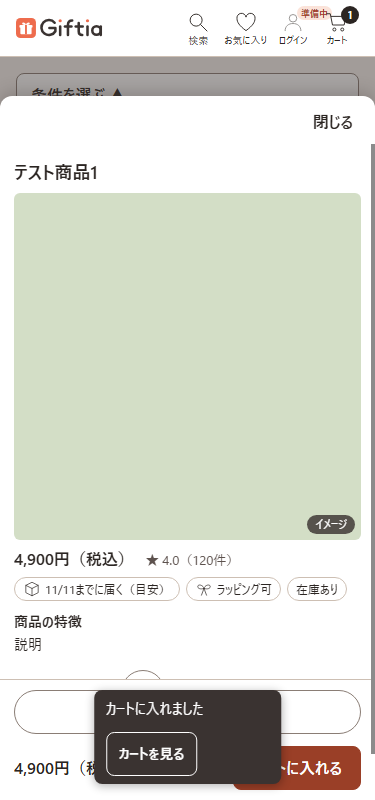
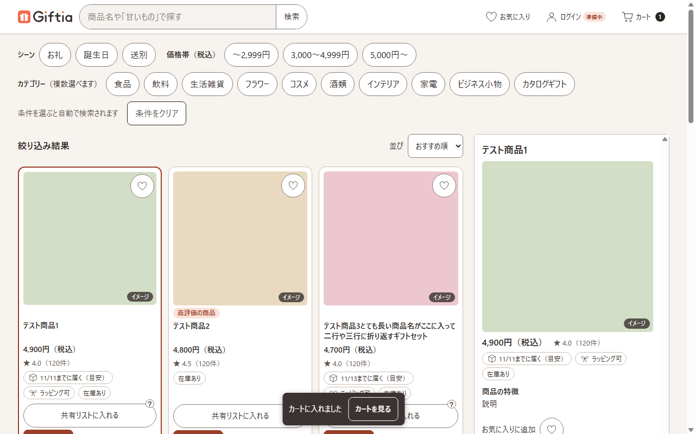
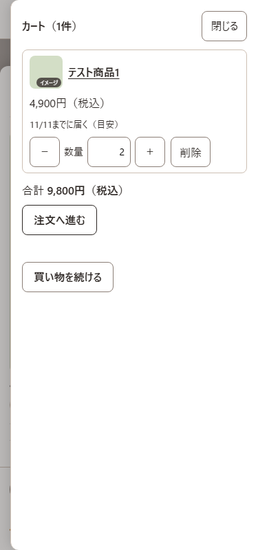
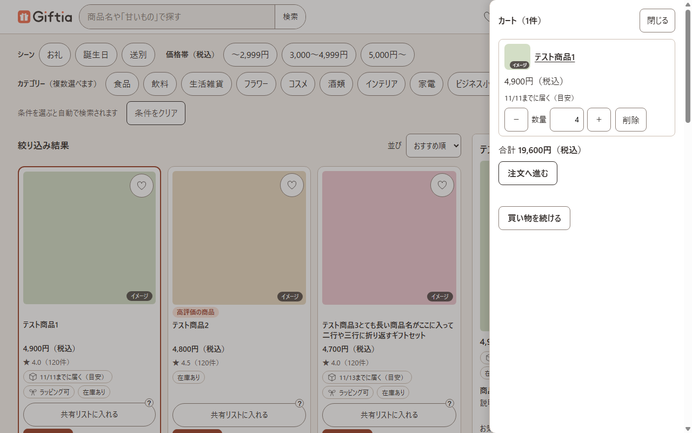
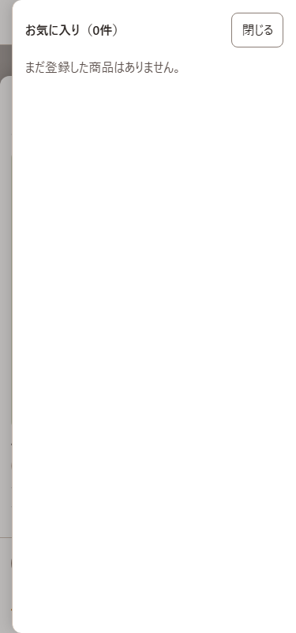
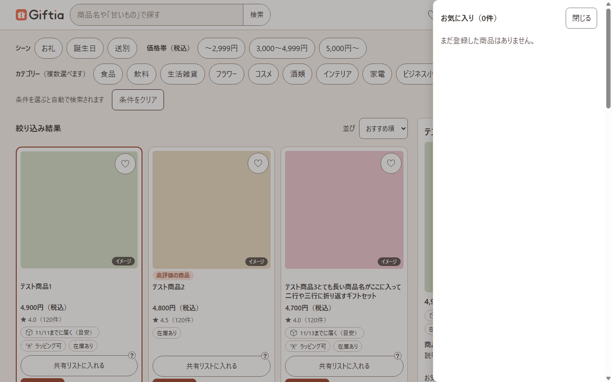
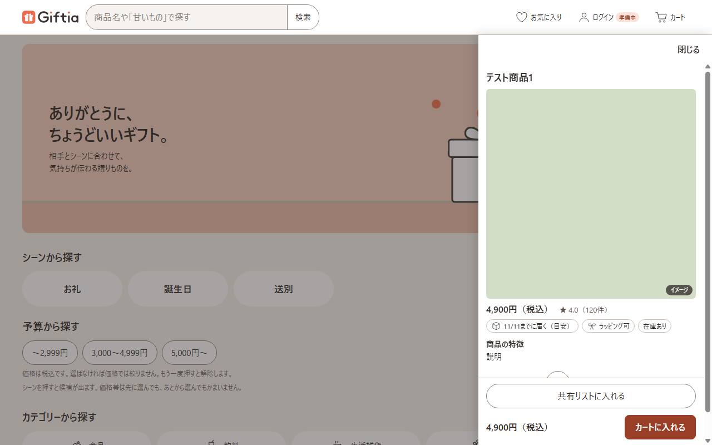
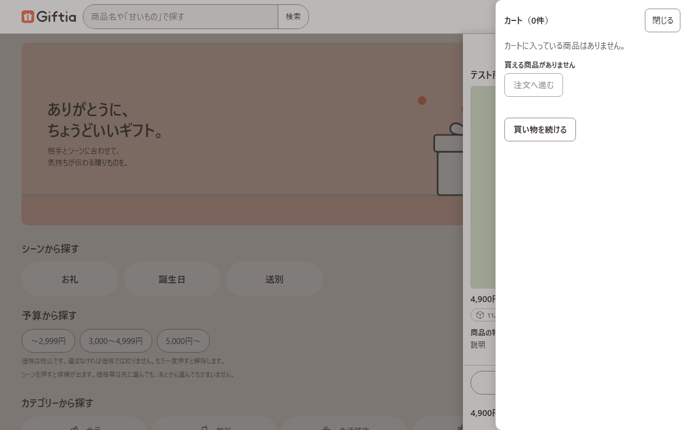
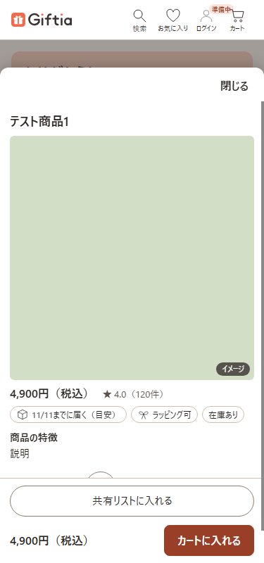
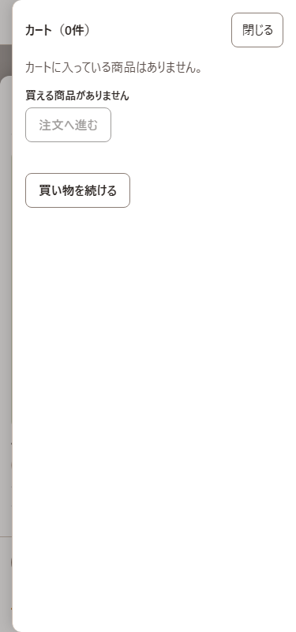

# S-131

## 独立評価（#242・2026-11-20・版 `285f83666ad9b8a9351a5dd5547068b05a99696f`）
判定なし（375px で④⑤の操作を人が行えない疑い） S-131（回した版 `285f836`）

### 期待結果
①詳細の「カートに入れる」→「カートに入れました」と「カートを見る」が詳細のシート・暗幕より手前の一番上に見える ②約 3 秒で消える ③「カートを見る」でカートのパネルが詳細より手前に開く ④詳細を開いたままカートのボタンを押す ⑤詳細を開いたままお気に入りのボタンを押す。どれも手前に開く。横スクロールなし（正本: `テスト設計.md` の S-131 の行）

### 実行
- だれ・いつ: Kurosu（AI・実装者ではない）、2026-11-20
- 場所・データ: 手元ビルド（`NEXT_PUBLIC_API_BASE=http://127.0.0.1:8766`）＋中継（計測の `POST /api/events` は 204 で捨てる。応答を遅らせる・500 を返す切替つき）。Chrome。幅は同じオリジンの iframe（375・1280px）。偽 API（共有リンクつき・詳細つき）: backend `285f836` の本物のアプリに `backend/tests/test_likes.py` の偽の DB（メモリ上の SQLite。FD-1）。評価用に、説明文・size の列と、商品の追加・削除（404 の再現）・在庫 0（P12）の管理口を足した（コミットしない）。本番には何も届かない
- 本番に行を作っていない

### 根拠
確認できた分（375px のシート）: ①通知が出て、その場所の一番上（`elementFromPoint` で通知自身が返る）。通知に「カートを見る」がある。②約 3.4 秒後に消えた。③「カートを見る」を押すとカートのパネルが開き、詳細より手前（パネルの中心が最前面）。横スクロールなし。
**④⑤で疑い**: 375px で詳細のシートを開くと、暗幕がヘッダーを覆い、ヘッダーのカート・お気に入りのボタンの位置を `elementFromPoint` で調べると暗幕が返る（押せない）。プログラムからの `click()` では、パネルが詳細より手前に開く。④⑤の「詳細を開いたまま、ヘッダーのボタンを押す」は、375px では人の操作で行えない。1280px では詳細は右の列で、ヘッダーは隠れない。文書の手順と実装の違いの疑いとして、判定せず報告する（直すか文書を直すかは PM の判断）。1280px の確認は未実施

### 証拠パス
- `evidence/S_評価_一覧.md`、`evidence/NF_S_評価_285f836.md`

---

## 追記: PC の幅の実クリック（2026-11-20）
- Chrome の本物の画面（幅 1960px。PC のレイアウト。右の列に詳細）で、詳細（`?product=P09`）を開いたまま、ヘッダーの「カート」と「お気に入り」を**実際のマウスクリック**で押した。どちらも、パネルが開き、パネルの中心が最前面（`elementFromPoint`）で、詳細は開いたまま。④⑤は PC の幅では押せる。
- 375px（下から出るシート）は、暗幕がヘッダーを覆い、ヘッダーのボタンを人が押せない疑い（前の記録のとおり）。実のクリックは、375px では窓の幅の制限（808px 未満にできない）で行えず、iframe の `elementFromPoint` で確認した。
- 判定なしのまま。「不具合か、文書が想定違いか」は、評価の後に PM が決める（S-11・S-38・S-56 と同じ扱い）。

## 直した後の確認（#581・PR #604・版 `7ed88d8`。Mi-rin・2026-11-22）
**判定: ○**（S-131 ①〜⑤。375px・1280px。①〜③は今までどおり、④⑤が 375px でも押せるようになった。PM 決定 2026-11-21 #581・案 A。詳細のシートの暗幕をヘッダーより下にした）

### 実行
- だれ・いつ: Mi-rin（AI。実装者）、2026-11-22。実装者自身の確認なので、独立した評価ではない。Kurosu の再確認で上書きしてよい。
- 場所・データ: `npm run build` → `next start`（PR #604 のブランチ `feat/581-581`、`7ed88d8`）をヘッドレス Chrome で操作。偽の API（`fetch` を差し替え。商品 G0001 の詳細・候補）。本番・班の DB には何も届かない。
- 幅: 375px・1280px（Chrome のウィンドウの幅を変えて測る。iframe ではない）。

### 根拠
| 手順 | 375px | 1280px | 判定 |
| --- | --- | --- | --- |
| ① 詳細の「カートに入れる」 | 「カートに入れました」「カートを見る」が出る。最前面（`elementFromPoint` が通知の中）。位置 上 690〜下 784 | 同じ（上 724〜下 784） | ○ |
| ② 約 3 秒待つ | 3.7 秒後に通知が 0 個 | 同じ | ○ |
| ③ もう一度入れて「カートを見る」 | カートのパネルが開き、中心が最前面（上 0〜下 800）。詳細は開いたまま | 同じ | ○ |
| ④ 詳細を開いたままカートのボタン | **ヘッダーのカートのボタンの中心が最前面（押せる）**。押すとカートのパネルが詳細より手前に開き、閉じても詳細は残る | 押せる・同じ | ○ |
| ⑤ 詳細を開いたままお気に入りのボタン | **押せる**。お気に入りのパネルが開き、中心が最前面 | 押せる・同じ | ○ |
| 横スクロール | 0 | 0 | ○ |
- 直す前（`285f836` 相当の main）の 375px: ヘッダーのカート・お気に入り・ロゴ・ログイン・虫めがねの中心は、すべて暗幕が最前面（押せない）。直した後はすべてそのボタン自身が最前面。数値は PR #604 の本文。
- 前提との違い: 実機ではなく、ヘッドレス Chrome の幅の切り替え。実のクリックではなく `click()` と `elementFromPoint` で確かめた（375px は窓の幅の制限があるため。前の記録と同じ）。
- 900px 以上の「詳細を右から出すパネル」が右端のヘッダーを覆う件は、仕様に書かれていない（PR #604 の本文）。この確認には含めない。

### 証拠ファイル（`pr-shots-581` ブランチの `pr-shots/581s131/`）
- 通知（①）:  
- カートのパネル（③）:  
- お気に入りのパネル（⑤）:  
- ④の前後（375px）: `pr-shots-581` の `pr-shots/581/before_375_1_detail_open.png`・`after_375_1_detail_open.png`

### ⑥ 900px 以上の詳細パネルの上端（版 `349709f`。#581・PR #604。Mi-rin・2026-11-22）
**判定: ○**（PM 決定 2026-11-22。パネルの上端＝ヘッダーの下端。どの幅でも詳細を開いたままヘッダーを押せる）
- 手順: トップで、おすすめのカードの商品名から詳細を開き、ヘッダーとパネルの位置を `getBoundingClientRect` で測り、ヘッダーのカートを**実際のマウスのクリック**（CDP の `Input.dispatchMouseEvent`）で押した。ヘッドレス Chrome・`next start`・偽の API。
| 幅 | ヘッダーの上端〜下端 | パネルの上端 | カートのボタン（最前面か） | 押した後 |
| --- | --- | --- | --- | --- |
| 1280px（右から出るパネル） | 0〜63px | **63px（ヘッダーの下端と同じ）** | 最前面（押せる） | カートのパネルが開き、詳細も開いたまま。横スクロール 0 |
| 375px（下から出るシート） | 0〜57px | 96px（シートは画面の下から出る。ヘッダーを覆わない） | 最前面（押せる） | 同じ。横スクロール 0 |
- 写真:    
- 実装者自身の確認。Kurosu の再確認で上書きしてよい。
