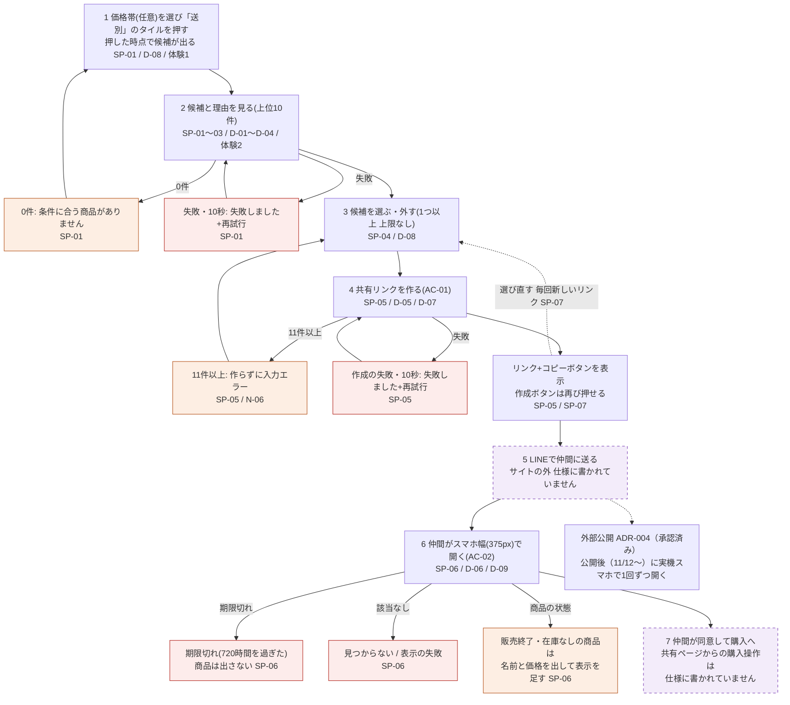
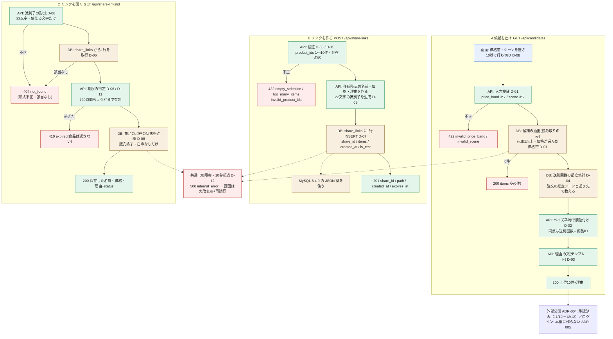
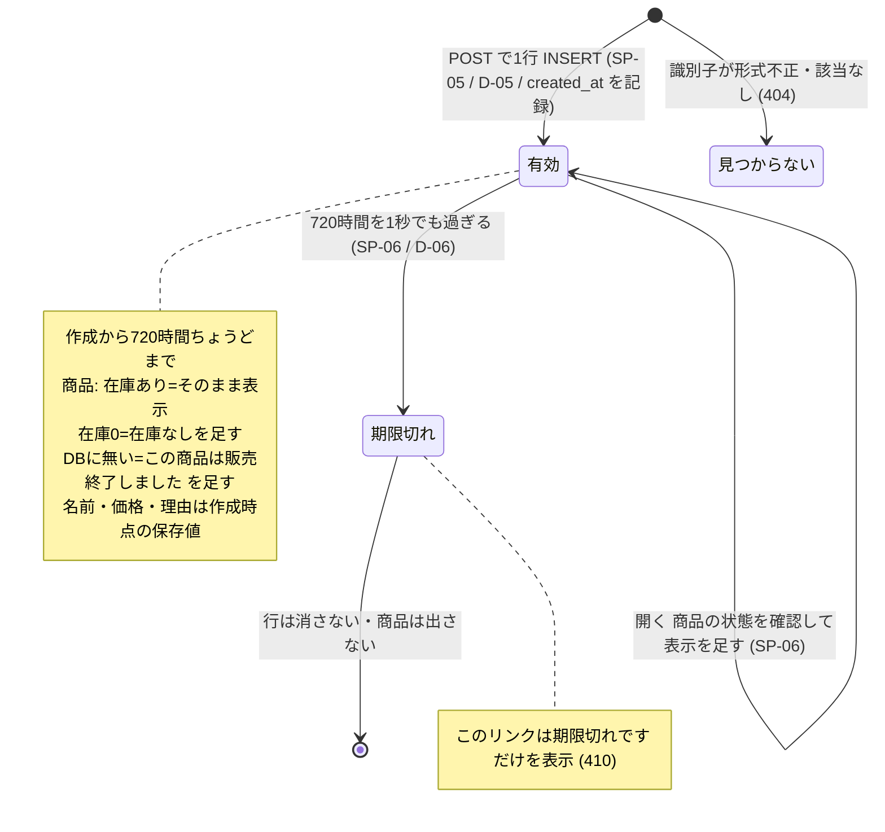

# 仕様 — Giftia UI/UX リニューアル

R-01（共同購入者）の導線から書く（ADR-002）。決定の根拠は `inputs/キックオフ記録.md` #22〜29。

## 主要導線

| 仕様ID | 要件ID | 利用者の操作 | UI状態 | API | データの変化 | 期待結果 |
| --- | --- | --- | --- | --- | --- | --- |
| SP-01 | F-01, F-01a | 価格帯（任意。「〜2,999円／3,000〜4,999円／5,000円〜」の3つのボタンから1つ。#49-1・2）とシーン（お礼・誕生日・送別の3つのタイルから1つ）を選ぶ。シーンを押した時点で候補が出る（「候補を出す」ボタンは置かない。#50-1）。シーンを選んだあとに価格帯を押したら、その場で出し直す（#51-1） | 初期 / 検索中 / 結果あり / 0件 / 失敗 | 設計.md 参照 | なし（読み取りのみ） | 選んだシーンのタグを持ち、（カテゴリーも選んでいれば、選んだカテゴリーのどれかで、）在庫が1以上で、価格が選んだ価格帯に入る（税込。〜2,999円は2,999円以下、3,000〜4,999円はその間、5,000円〜は5,000円以上。両端を含む）商品から、上位10件を順位順に表示する（#49-1）。価格帯は任意で、選ばなければ、シーンと在庫だけで絞り、価格では絞らない（並べ方・理由の文は同じ。#49-3）。同じボタンをもう一度押すと選択が外れる（#49-3）。ボタンの文字は「3,000〜4,999円」（#49-2）。API に範囲外の値（価格帯・シーン）が直接届いたら入力エラーで返す（#49-5）。`price_band=` が空で届いたら価格帯なしとして扱う。`budget` は読まずに無視し、エラーにしない（#51-4） |
| SP-02 | F-01a | （順位付け） | — | — | — | 件数の割り引きつき評価（ベイズ平均）の高い順。点数 ＝ (v ÷ (v＋20)) × R ＋ (20 ÷ (v＋20)) × C。R は商品の評価、v はレビュー件数、C は SP-01 で絞り込んだ候補のうち評価があり件数1以上の商品の平均評価（#37-5）。評価・件数のどちらかが無い商品は v＝0（点数＝C）。全候補に評価が無ければ全員同点。同点は職場の送別での回数が多い順、次に商品ID順（#30 B） |
| SP-03 | F-02 | 候補を見る | 結果あり | SP-01 に含む | なし | 各候補に、理由を自然な文で表示する。事実をテンプレートでつなげる（AI は使わない）。値のある材料の文だけを順につなげ、値の無い材料は文に入れない。「と高めです」は評価4.5以上のときだけ（高評価バッジと同じ基準）。「評価も」は「〜選ばれていて、」とつなぐときだけ使い、それ以外は「評価は」で始める。評価があっても件数0なら評価の文を入れない。ラッピング不可と値なしは、どちらも文に入れない（#32-2〜4）。例: 「職場の送別で48回選ばれていて、評価も4.6（120件）と高めです。2日で届き、ラッピングもできます。」／「職場の送別で12回選ばれています。評価は4.2（30件）です。3日で届きます。」／送別回数0「職場の送別での購入は、まだありません。評価は4.0（8件）です。2日で届きます。」（#30 A・E） |
| SP-04 | F-03 | 候補を選ぶ・外す | 選択中の数を表示 | なし（画面内） | 画面内の選択だけ | 1つ以上、上限なしで選べる |
| SP-05 | F-04 | 選んだ候補で共有リンクを作る | 作成中 / 成功 / 失敗 | 設計.md 参照 | 共有リンクを1件作る（作成時点の商品名・価格・理由を保存） | 1つ以上10件以下を選んでいれば、サイトを閉じずにリンクが作られる。11件以上なら作らずに入力エラー（N-06）。11件以上を選んでいる間は、作成ボタンのすぐ上に「共有リンクに入れられるのは10件までです。選ぶ数を減らしてください」と出し、ボタンを押せない（選択数はそのまま表示）。同じ商品IDが重なって届いたら1件にまとめ、エラーにしない（#36）。0件選択と作成中は作成ボタンを押せない。識別子は推測できない22文字のランダム文字列（英大文字・英小文字・数字・「-」「_」）。作成後はリンクとコピーボタンを表示し、作成ボタンは再び押せる状態に戻す（#30 I・K）。コピーボタンを押すとリンクをコピーし、ボタンの近くに「コピーしました」を2秒表示。失敗したら「コピーできませんでした。リンクを長押ししてコピーしてください」を、次にコピーボタンを押すまで表示したままにする（#32-6、#33）。共有リンクを作り直したら、画面には新しいリンクに置き換えて最新の1本だけ出す。前のリンクも期限（720時間）までは開ける（#41-1） |
| SP-06 | F-05 | 共有リンクを開く（ログインなし） | 読み込み中 / 表示 / 期限切れ / 見つからない | 設計.md 参照 | なし | 作成時点の商品名・価格・理由を表示する。販売終了と在庫なしだけは開いた時点で確かめる（商品が DB に無ければ「この商品は販売終了しました」、在庫0なら「在庫なし」。作成時点の商品名・価格は出したまま、この表示を足す。#32-5）。「このページはリンクを知っている人なら誰でも見られます」の注記を、商品の一覧のすぐ下に、「表示」のときだけ出す（#54-7）。作成から720時間ちょうどまでは表示し、1秒でも過ぎたら（サーバー時刻）商品は出さず「このリンクは期限切れです」だけを表示。スマホ 375px・PC 1280px で崩れない（#30 G・H） |
| SP-07 | F-04 | 選び直す・同じ選び方でもう一度作る | — | — | 新しい共有リンクを作る | 作成済みのリンクの中身は変えない。同じ選び方でも毎回新しいリンクを作る |
| SP-08 | F-10 | どの画面でもヘッダーを見る・使う | 共通 | なし | なし | ロゴ・検索欄・お気に入り・ログイン・カートの順に並べる。トップ・検索結果・共有ページで同じ。ロゴを押すとトップへ。検索欄は押せない入力欄の中に薄い字で「準備中」（#41-8。中身は今回作らない。#46-7）。ログインは「準備中」（押しても何も起きない。本番には作らない。#65）。お気に入りを押すと SP-13、カートを押すと SP-14 を開く。「取引先へのお礼」「ギフトを探す」「カートに入れる」は置かない（#45-7、AC-03） |
| SP-09 | F-11, F-12 | トップを開く。シーンのタイル・価格帯ボタン・カテゴリーのタイルを押す | 初期 | なし（トップの表示だけ）。おすすめは SP-10 の API | なし | 上から順に、ヒーロー、ヒーローの下に、シーンのタイル3つと価格帯のボタン3つを1組で並べ、「シーンから探す」「予算から探す」はその組の見出しにする（#55-5）。「シーンから探す」（お礼・誕生日・送別の3タイル。「取引先へのお礼」は置かない。#50-6。「候補を出す」ボタンは置かない。#50-1）、「予算から探す」（〜2,999円・3,000〜4,999円・5,000円〜 の3ボタン。OPEN-03。案A の画像の「3,000〜5,000円」は使わない。#49-2）、「カテゴリーから探す」（10個のアイコン付きタイル。スマホの幅（480px 以下）では、トップの「カテゴリーから探す」を折りたたむ。見出し「カテゴリーから探す ▼」だけを出し、押すと10個のボタンが開く。最初は閉じている。検索結果の画面のカテゴリーとパソコンの幅は変えない（#61-1〜3）。開閉のボタンはキーボードで操作でき（Tab で届き、Enter・Space で開閉）、開閉の状態を読み上げに伝える（`aria-expanded`。#61）。生活雑貨・食品・コスメ・飲料・家電・インテリア・ビジネス小物・フラワー・酒類・カタログギフト。#54-5）、「おすすめの商品」（おすすめ順の上位4件を4列に並べる。#53-1。押すと検索結果の画面で、その商品の詳細の欄を開く。#46-2）。シーンのタイルを押すと検索結果へ移り、その場で R-01 の10件（SP-15。価格帯を選んでいればその価格帯で）を出す（SRC-03。#50-1、#51-1・2）。価格帯ボタンは、シーンを選んでいればその場で候補を出し直し、シーンが未選択なら選ぶだけ（#51-1）。カテゴリーのタイルは押すと、そのカテゴリー1つを選んだ状態で検索結果へ移る。2つ目からは検索結果の画面で足す（#58-4）。シーンが無ければ R-02 の12件ずつ（おすすめ順）、シーンも選んでいれば R-01 の10件をそのカテゴリーで絞って出す（#54-5、#56-1）。同じタイルをもう一度押すとカテゴリーを外す（#56-1）。価格は R-01（SP-01）も R-02（SP-10）も価格帯の3ボタン（#48・#49-1。#45-2 の自由入力は取り消し）。トップでシーンが未選択のまま価格帯だけを選んだら、価格帯ボタンの下に「この価格帯の商品を見る」のリンクを出し、押すと R-02 の12件ずつ（おすすめ順）に進む。シーンも選んでいるとき、価格帯を外したときは出さない（#54-8）（#53-3） |
| SP-10 | F-12, F-18 | 検索結果で、シーン・価格帯・カテゴリーを選ぶ。「条件をクリア」を押す | 検索中 / 結果あり / 0件 / 失敗 | 設計.md 参照（D-28） | なし（読み取りのみ） | 条件の並びは1行目がシーンと価格帯、2行目がカテゴリー（文字だけのボタン）。各条件は単一選択、条件間は AND（OPEN-02）。選ぶと検索ボタンなしで自動で検索し、結果を出し直す。選んだボタンは見て分かる状態にする。「条件を選ぶと自動で検索されます」を条件の下に常に出す。「条件をクリア」でシーン・価格帯・カテゴリーのすべてを外す。選んだ候補は残す（#50-2）。選んでいるボタンをもう一度押すと、その条件が外れる（#46-1）。結果は、シーンがあれば R-01 の10件（SP-15。カテゴリーも選んでいれば、選んだカテゴリーのどれかに絞った10件。#55-1）、シーンが無く価格帯かカテゴリーがあれば R-02 の12件ずつ（おすすめ順）（#51-2、#54-5）。「条件をクリア」でカテゴリーも外れ、選んだ候補は残る（#55-3）。条件ボタンを押した時点で結果を出し直す（#50-1、#51-1）。キーワードは今回作らない（#46-7）。続けて条件を変えたら最新の条件の結果だけを残し、古い条件の応答は捨てる（AC-11）。カテゴリーの文字ボタンは10個（生活雑貨・食品・コスメ・飲料・家電・インテリア・ビジネス小物・フラワー・酒類・カタログギフト）。「準備中」は外す。押すたびに選ぶ・外すが切り替わり、ほかのカテゴリーは外さない。複数選べ、選んだどれかに当てはまる商品を出す（シーン・価格帯とは両方に合うもの）。選んでいるボタンには✓印を付け、色だけに頼らない。選べる数に上限はなく、10個全部は何も選ばないのと同じ（#57、#58-1・2・5）（#45-2〜4、AC-05・AC-06・AC-11） |
| SP-11 | F-13, F-16 | 検索結果のカード・ページ送りを見る・押す | 結果あり | 設計.md 参照（D-28） | なし | 結果を12件ずつ、おすすめ順（SP-02 と同じ式の点数の高い順。絞り込んだ商品で C を求める。同点は商品ID順。#46-2、#50-3）に、カード型で並べる。在庫が0の商品は出さない。条件を付けないときは全商品をおすすめ順に12件ずつ（#46-3）。カードは画像（カテゴリー共通イラストに「イメージ」と表記）・商品名・価格（「4,000円（税込）」#41-9）・評価と件数（「4.7（120件）」）・配送日数（「3日でお届け」）・ラッピング可・お気に入りのハート。評価が4.5以上のカードには「高評価の商品」（SP-03 の高評価バッジと同じ基準）。評価・件数・配送日数・ラッピングのどれかが無い商品は、その項目だけ出さない（値を作らない。OPEN-06）。カードの本体を押すと SP-12。下に「全n件中a〜b件を表示」とページ番号・次へ（案A）。ページ送りは同じ条件のまま次の12件に替える（#45-5・6）。範囲外のページ番号が来たら1ページ目を出す（#46-5） |
| SP-12 | F-14, F-16 | カードを押して詳細を見る | 詳細の欄 | 設計.md 参照（D-29） | なし | 検索結果の右に詳細の欄を出す。商品名・画像・価格（税込）・評価（件数）・「高評価の商品」・配送日数・ラッピング・商品の特徴・セット内容、「カートに入れる」と「お気に入りに追加」。ハートは SP-13、「カートに入れる」は SP-14 と同じ状態を見る。下端が切れたり重なったりしない（AC-08）。詳細の取得が通信の失敗なら、詳細の欄に「商品の情報を読み込めませんでした」と「もう一度」ボタンを出す。404 なら「この商品は見つかりません」（「もう一度」ボタンは付けない。#58-10）を出す（#55-4）。「商品の特徴」は商品の説明文、「セット内容」はサイズの列の値を出す。値が無ければ出さない（#45-6、#54-6）。在庫0の商品は詳細の欄に「在庫なし」と出す。詳細 API は在庫0でも404にせず、商品情報と在庫なしの状態を返す（#53-5） |
| SP-13 | F-15 | カード・詳細のハート、またはヘッダーのお気に入りを押す | 登録済み / 未登録 | なし（ブラウザ内保存、D-10） | ブラウザ内の保存だけ | ハートで登録・解除。お気に入りの一覧（ヘッダーから開く。右から出るパネル。#46-6）と、カード・詳細のハートの状態は同じ。同じ商品は重複しない。再読込後も残る。保存が使えない環境でも画面は壊れない（#45-7、AC-09） |
| SP-14 | F-17 | 「カートに入れる」・ヘッダーのカートを押す | カートの中身 | なし（ブラウザ内保存、D-10） | ブラウザ内の保存だけ | 追加すると数量1（同じ商品は数量+1）。カートの中で数量変更・削除・合計（税込）。カートは右から出るパネルで開く。数量は1〜99。直接入力でき、100以上を入れたら99に直す（#50-5、#51-3）。数量の欄に空・小数・数字以外を入れたら、欄を離れた時点で直前の数量に戻す。0以下は1にする（#53-4）。全角の数字は半角に直して受け付ける（#54-9）。全角と半角が混ざった入力（「１2」）も全部半角に直して受け付ける。全角の小数点（「１．５」）は小数として、直前の数量に戻す（#56-3）。カートを開くとき、保存した商品ごとに詳細（SP-12 と同じ情報）で確かめ、販売終了は「販売終了」、在庫0は「在庫なし」と出し、どちらも合計に入れない（#50-4、#53-5）。「注文へ進む」を押すと「デモのため、注文はできません」（#26・#27、#45-7、#46-6） |
| SP-15 | F-19 | トップまたは検索結果でシーンを選ぶ（価格帯は任意） | 結果あり / 0件 / 失敗（SP-01 のとおり） | SP-01 のとおり | なし | 検索結果の画面に、R-01 の上位10件を順位順に出す（ページ送りなし）。カードは SP-11 と同じ枠に、順位・理由の文（SP-03）・「選ぶ」を足す。右に詳細の欄（SP-12）。SP-04（選ぶ・外す）・SP-05（共有リンクを作る）は、この画面の「選んだ候補」の欄で行う。R-01 の10件が出るのはシーンがあるときだけ。シーンとカテゴリーを両方選んだら、R-01 の10件も選んだカテゴリーのどれかに当てはまる商品に絞ってから順位を付ける（#55-1、#58-6）。シーンが無く価格帯だけなら R-02 の12件（SP-10）に切り替わり、選んだ候補は残す（#51-2）（#45-1・5・6） |

## 画面の細部（キックオフ記録 #37、一括確認8）

| 対象 | 決定 |
| --- | --- |
| トップのカテゴリー（スマホ幅） | 検索結果からトップに戻ったときも、開閉の状態は覚えず、毎回閉じた状態から始める。幅が 480px をまたいだら、広くなれば開閉ボタンを消して常に開いた表示にし、狭くなれば閉じた状態から始める。開いたら見出しの印を ▼ から ▲ に変える（#62-1〜3）。スマホの幅（480px 以下）では、トップの「カテゴリーから探す」を折りたたむ。見出し「カテゴリーから探す ▼」だけを出し、押すと10個のボタンが開く。最初は閉じている。検索結果の画面のカテゴリーとパソコンの幅は変えない（#61-1〜3）。開閉のボタンはキーボードで操作でき（Tab で届き、Enter・Space で開閉）、開閉の状態を読み上げに伝える（`aria-expanded`。#61） |
| 検索結果の見出し | R-01 の結果（SP-15）では「候補（n件）」。10件未満でもそのまま出す。「候補（n件）」の横の説明には、カテゴリーを選んでいれば、選んだカテゴリーを「・」でつないで全部出す（並びはタイルの並び順＝生活雑貨・食品・コスメ・飲料・家電・インテリア・ビジネス小物・フラワー・酒類・カタログギフト。選んだ順にしない。#59-1）（#58-7）。R-02 の絞り込み（SP-10・SP-11）では「全n件中a〜b件を表示」（#45-5） |
| 候補のカード | 順位・画像（カテゴリー共通イラスト「イメージ」）・商品名・価格・理由の文・高評価バッジ（4.5以上） |
| 評価の表示 | データの値のまま（4.49 は 4.49） |
| シーン未選択の検索 | シーンが無く価格帯だけのときは R-02 の12件（おすすめ順）。シーンも価格帯も無いときは全商品を12件ずつ（#46-3、#51-2）。「候補を出す」ボタンは置かない（#50-1） |
| 検索中 | 「あかぷさんの顔」が回る表示。画像はレージがあとで渡す（リポジトリに置く）。届くまでは仮の回る表示（#39-2） |
| ヘッダー | 検索ボックスを置く。商品名に含まれる言葉で探す。中身は今回作らず、置くだけ（#46-7）。押せない入力欄の中に薄い字で「準備中」（#39-1、#41-8）。お気に入り・カートの入口は動く、ログインは「準備中」（SP-08。#45-7） |
| 検索し直したときの選択 | 残す。検索結果の下に「選んだ候補」の欄を作ってまとめて出す。10件を超えたら #36 の表示（#39-3） |
| 「選んだ候補」の外し方 | 「選んだ候補」の各商品に「外す」ボタン。結果一覧で選び直しても外せる（#41-5） |
| 「選択中」の表示 | 「選んだ候補」と結果一覧の両方に出る商品は、結果のカードに「選択中」と出す（#41-6） |
| 共有ページの注記 | 商品の一覧のすぐ下に、「表示」のときだけ出す。期限切れ・見つからない・失敗には出さない（#54-7） |
| 「選んだ候補」の並び | 選んだ順。共有リンクの並びと同じ（#41-7） |
| 0件の文言 | 0件の文言は、カテゴリーを選んでいれば「この条件に合う商品がありません。カテゴリーを変えてみてください」、なければ価格帯を選んでいれば「条件に合う商品がありません。価格帯を変えてみてください」、どちらもなければ「この条件に合う商品がありません。シーンを変えてみてください」（#56-4。#55-2、#41-2、#49-4） |
| 配色（クリスマス） | 案A の骨格（AC-12）は変えず、配色と質感だけをクリスマスカラーにする。色は1か所の設定にまとめ（N-14）、元の淡色に切り替えられる。文字と背景の差は WCAG AA（N-12）を守り、赤と緑の違いだけで意味を伝えない（#52） |
| 価格の表示 | 「1,500円（税込）」（カンマ区切り、「円」の後ろに「（税込）」。#39-7、#41-9） |
| リンク作成後に選び直す | 表示中のリンクは残す。作り直したら新しいリンクに置き換え、最新の1本だけ出す。前のリンクも720時間までは開ける（#41-1） |
| リンク作成の失敗後に再試行 | 選択・入力は残す |
| 「コピーしました」表示中に再び押す | コピーし直し、2秒を数え直す |
| 共有ページ | 購入操作・LINE 直送・延長・再発行・取り消しは置かない。商品は選んだ順。上部に「作成時点の商品名・価格です」。価格差の注記は出さない。ヘッダーは検索ページと同じで、ロゴで検索ページへ戻る |
| 共有ページの期限切れ | 「このリンクは期限切れです」に「作った人に、新しいリンクを頼んでください」を添える |
| 共有リンクの URL の頭 | 公開先のドメイン（Azure が付ける 〜.azurewebsites.net。#65）。画面が今開いているサイトの送信元を使う |
| SP-02 の C | 評価があっても件数0の商品は含めない（#32-3 とそろえる） |

## API

設計の段で決める（未決）。

## データ

| データID | 項目 | 型・制約 | 保存先 | 作成・更新・削除の条件 |
| --- | --- | --- | --- | --- |
| DATA-01 | 職場の送別で贈られた回数 | 商品ごとの整数。注文のうち推定シーン＝送別、かつ会社宛ての件数 | 保存しない。候補を出すたびに注文データから集計（#24） | 既存の注文データから集計。新しい列は足さない（ADR-003） |
| DATA-02 | 共有リンク | 推測できない22文字以上の識別子、選んだ商品ごとの作成時点の商品ID・商品名・価格・理由、作成日時、テスト用の印（テストで作った行だけ印あり。N-09） | 班の DB `giftia_t501` に共有リンク用の新しいテーブルを1つ作る。既存テーブルは変更しない（#24） | SP-05 で作成。更新しない。作成から720時間（サーバー時刻）で期限切れ |

## 待ち時間、失敗、再試行

| 仕様ID | 状況 | 表示 | 利用者ができること | データ整合性 |
| --- | --- | --- | --- | --- |
| SP-10・SP-11 | 絞り込みの検索の失敗・10秒で打ち切り | 「失敗しました。もう一度お試しください」と再試行ボタン（SP-01 と同じ。#46-5、AC-11） | 再試行 | 変化なし |
| SP-10・SP-11 | 絞り込みの結果が0件 | カテゴリー→価格帯→シーンの順に、選んでいる条件の名前を入れた文言（画面の細部「0件の文言」。#56-4）（#46-5。AC-11） | 条件を変える・「条件をクリア」 | 変化なし |
| SP-01 | 候補が0件（価格帯あり） | 「条件に合う商品がありません。価格帯を変えてみてください」（#49-4） | 価格帯を変えて出し直す | 変化なし |
| SP-01 | 候補が0件（価格帯なし） | 「この条件に合う商品がありません。シーンを変えてみてください」（#41-2、#49-4） | シーンを変えて出し直す | 変化なし |
| SP-01 | 検索の失敗・10秒で打ち切り | 「失敗しました。もう一度お試しください」と再試行ボタン | 再試行 | 変化なし |
| SP-05 | リンク作成の失敗・10秒で打ち切り | 同上 | 再試行 | 失敗なら作られない。打ち切り後にサーバー側で作られることは許す（個人情報なし、誰にも見られず720時間で期限切れ。#30 C） |
| 共通 | 10秒に達した時点で打ち切り | 上の失敗表示 | 再試行 | 打ち切り後に届いた応答は画面に出さずに捨てる（#30 J） |
| SP-06 | 表示の失敗・10秒で打ち切り | 同上 | 再試行 | 変化なし |
| SP-06 | 期限切れ・見つからない | 「このリンクは期限切れです」／「リンクが見つかりません」 | なし | 変化なし |

## 対象外・保留・ADR

- 対象外: 相手の年代の入力・絞り込み（キックオフ記録 #21）、1人あたり金額の表示と人数の入力（#23）、新しい属性タグ・生成AIによる理由（ADR-003）
- 保留: API・保存先・失敗時の表示（設計の段）。R-02（SP-08〜SP-15）の未決は設計.md「残る未決」の なし（R2-1〜15 は閉じた。R2-4 は #54、R2-15 は #55 で閉じた）
- 関連ADR: ADR-002（R-01 先行）、ADR-003（既存の列だけ）

## 主要フロー（Mermaid）

R-01 の主要な流れを3枚の図にした。表の仕様（SP-01〜07）を目で追うための写しで、**表と食い違うときは表が正**。図の ID は仕様ID（SP）・設計ID（D）・受入基準（AC）。灰色の破線＝未決・承認待ち、紫の破線＝この仕様に書かれていない所。見やすい版は `evidence/mock/flows.html`（Artifact 表示用の写し）。

### 1. 顧客視点（Aさんが仲間に候補を送って決める）

### 2. システム視点（画面・API・DB）

### 3. 共有リンクの状態

