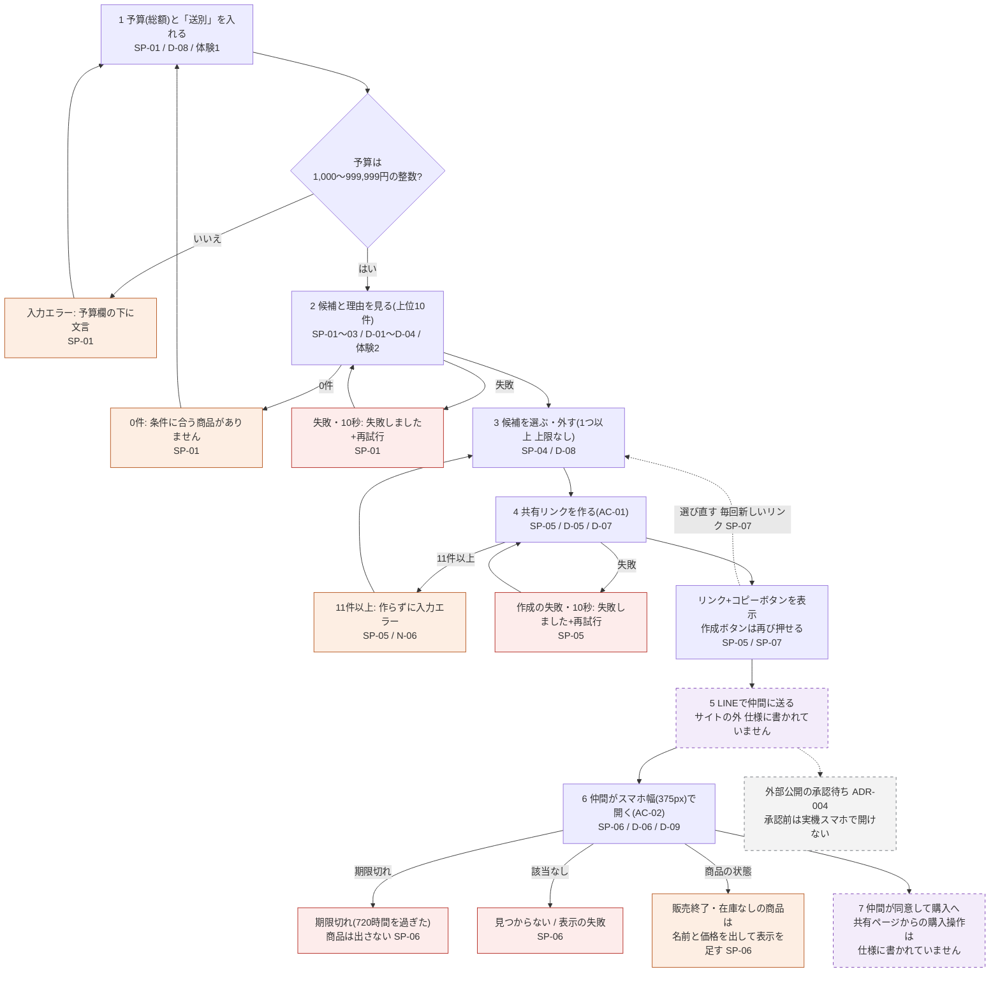
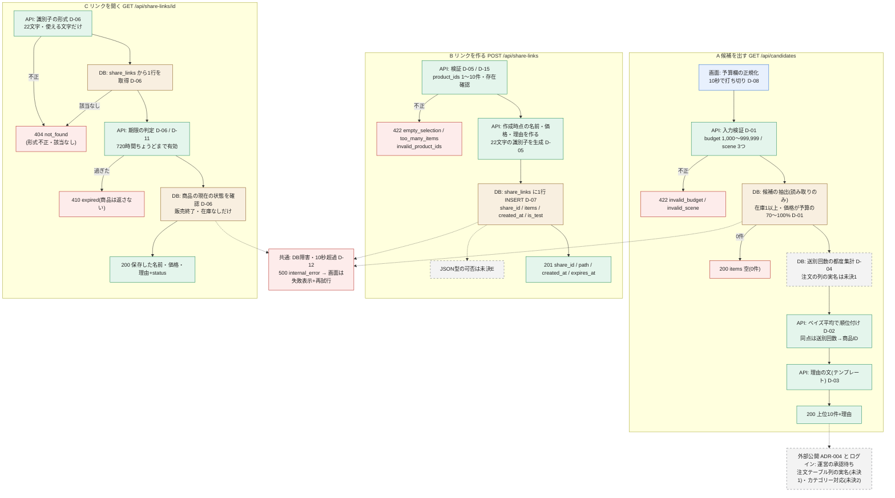
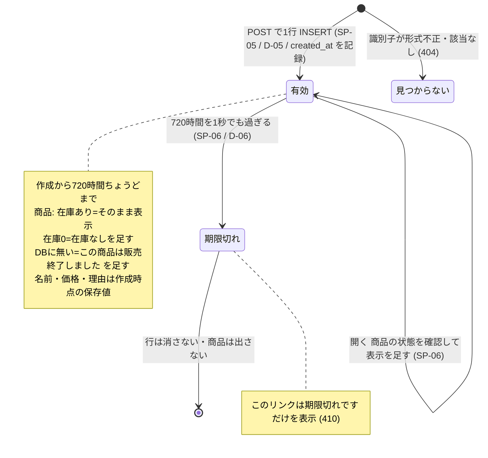

# 仕様 — Giftia UI/UX リニューアル

R-01（共同購入者）の導線から書く（ADR-002）。決定の根拠は `inputs/キックオフ記録.md` #22〜29。

## 主要導線

| 仕様ID | 要件ID | 利用者の操作 | UI状態 | API | データの変化 | 期待結果 |
| --- | --- | --- | --- | --- | --- | --- |
| SP-01 | F-01, F-01a | 予算（総額、任意。入れるなら1,000〜999,999円の整数。#39）とシーン（お礼・誕生日・送別の3つのボタンから1つ）を入れて候補を出す | 初期 / 検索中 / 結果あり / 0件 / 失敗 / 入力エラー | 設計.md 参照 | なし（読み取りのみ） | 選んだシーンのタグを持ち、在庫が1以上で、価格が予算の70%以上100%以下（両端を含む。70%は四捨五入せず「価格 × 10 ≧ 予算 × 7」で比べる）の商品から、上位10件を順位順に表示する。予算を入れないときは、シーンと在庫だけで絞り、価格では絞らない（並べ方・理由の文は同じ。#39）。予算の欄が空白だけなら予算なしとして扱う（#41-3）。API に `budget=` が空で届いたら予算なしとして扱う。画面からは送らない（#41-4）。入力欄は「予算（任意）」、薄い字で「例：4,500」。予算欄は全角数字を半角に直し、カンマと前後の空白を除き、先頭の0は無視して読む（「４，５００」→ 4500。#32-1）。範囲外・整数でない予算は、予算欄のすぐ下に「予算は1,000〜999,999円の整数で入れてください」。API に範囲外の値（予算・シーン）が直接届いたら入力エラーで返す（#30 D・F、#31） |
| SP-02 | F-01a | （順位付け） | — | — | — | 件数の割り引きつき評価（ベイズ平均）の高い順。点数 ＝ (v ÷ (v＋20)) × R ＋ (20 ÷ (v＋20)) × C。R は商品の評価、v はレビュー件数、C は SP-01 で絞り込んだ候補のうち評価があり件数1以上の商品の平均評価（#37-5）。評価・件数のどちらかが無い商品は v＝0（点数＝C）。全候補に評価が無ければ全員同点。同点は職場の送別での回数が多い順、次に商品ID順（#30 B） |
| SP-03 | F-02 | 候補を見る | 結果あり | SP-01 に含む | なし | 各候補に、理由を自然な文で表示する。事実をテンプレートでつなげる（AI は使わない）。値のある材料の文だけを順につなげ、値の無い材料は文に入れない。「と高めです」は評価4.5以上のときだけ（高評価バッジと同じ基準）。「評価も」は「〜選ばれていて、」とつなぐときだけ使い、それ以外は「評価は」で始める。評価があっても件数0なら評価の文を入れない。ラッピング不可と値なしは、どちらも文に入れない（#32-2〜4）。例: 「職場の送別で48回選ばれていて、評価も4.6（120件）と高めです。2日で届き、ラッピングもできます。」／「職場の送別で12回選ばれています。評価は4.2（30件）です。3日で届きます。」／送別回数0「職場の送別での購入は、まだありません。評価は4.0（8件）です。2日で届きます。」（#30 A・E） |
| SP-04 | F-03 | 候補を選ぶ・外す | 選択中の数を表示 | なし（画面内） | 画面内の選択だけ | 1つ以上、上限なしで選べる |
| SP-05 | F-04 | 選んだ候補で共有リンクを作る | 作成中 / 成功 / 失敗 | 設計.md 参照 | 共有リンクを1件作る（作成時点の商品名・価格・理由を保存） | 1つ以上10件以下を選んでいれば、サイトを閉じずにリンクが作られる。11件以上なら作らずに入力エラー（N-06）。11件以上を選んでいる間は、作成ボタンのすぐ上に「共有リンクに入れられるのは10件までです。選ぶ数を減らしてください」と出し、ボタンを押せない（選択数はそのまま表示）。同じ商品IDが重なって届いたら1件にまとめ、エラーにしない（#36）。0件選択と作成中は作成ボタンを押せない。識別子は推測できない22文字のランダム文字列（英大文字・英小文字・数字・「-」「_」）。作成後はリンクとコピーボタンを表示し、作成ボタンは再び押せる状態に戻す（#30 I・K）。コピーボタンを押すとリンクをコピーし、ボタンの近くに「コピーしました」を2秒表示。失敗したら「コピーできませんでした。リンクを長押ししてコピーしてください」を、次にコピーボタンを押すまで表示したままにする（#32-6、#33）。共有リンクを作り直したら、画面には新しいリンクに置き換えて最新の1本だけ出す。前のリンクも期限（720時間）までは開ける（#41-1） |
| SP-06 | F-05 | 共有リンクを開く（ログインなし） | 読み込み中 / 表示 / 期限切れ / 見つからない | 設計.md 参照 | なし | 作成時点の商品名・価格・理由を表示する。販売終了と在庫なしだけは開いた時点で確かめる（商品が DB に無ければ「この商品は販売終了しました」、在庫0なら「在庫なし」。作成時点の商品名・価格は出したまま、この表示を足す。#32-5）。作成から720時間ちょうどまでは表示し、1秒でも過ぎたら（サーバー時刻）商品は出さず「このリンクは期限切れです」だけを表示。スマホ 375px・PC 1280px で崩れない（#30 G・H） |
| SP-07 | F-04 | 選び直す・同じ選び方でもう一度作る | — | — | 新しい共有リンクを作る | 作成済みのリンクの中身は変えない。同じ選び方でも毎回新しいリンクを作る |

## 画面の細部（キックオフ記録 #37、一括確認8）

| 対象 | 決定 |
| --- | --- |
| 検索結果の見出し | 「候補（n件）」。10件未満でもそのまま出す |
| 候補のカード | 順位・画像（カテゴリー共通イラスト「イメージ」）・商品名・価格・理由の文・高評価バッジ（4.5以上） |
| 評価の表示 | データの値のまま（4.49 は 4.49） |
| シーン未選択で「候補を出す」 | 「シーンを選んでください」 |
| 検索中 | 「あかぷさんの顔」が回る表示。画像はレージがあとで渡す（リポジトリに置く）。届くまでは仮の回る表示（#39-2） |
| ヘッダー | 検索ボックスを置く。商品名に含まれる言葉で探す。中身は R-02 の要件追記時に決め、それまでは置くだけ。押せない入力欄の中に薄い字で「準備中」（#39-1、#41-8）。お気に入り・ログイン・カートの入口（R-02 まで「準備中」） |
| 検索し直したときの選択 | 残す。検索結果の下に「選んだ候補」の欄を作ってまとめて出す。10件を超えたら #36 の表示（#39-3） |
| 「選んだ候補」の外し方 | 「選んだ候補」の各商品に「外す」ボタン。結果一覧で選び直しても外せる（#41-5） |
| 「選択中」の表示 | 「選んだ候補」と結果一覧の両方に出る商品は、結果のカードに「選択中」と出す（#41-6） |
| 「選んだ候補」の並び | 選んだ順。共有リンクの並びと同じ（#41-7） |
| 0件の文言 | 予算ありの0件は「条件に合う商品がありません。予算を変えてみてください」。予算なしの0件は「この条件に合う商品がありません。シーンを変えてみてください」（#41-2） |
| 価格の表示 | 「1,500円（税込）」（カンマ区切り、「円」の後ろに「（税込）」。#39-7、#41-9） |
| リンク作成後に選び直す | 表示中のリンクは残す。作り直したら新しいリンクに置き換え、最新の1本だけ出す。前のリンクも720時間までは開ける（#41-1） |
| リンク作成の失敗後に再試行 | 選択・入力は残す |
| 「コピーしました」表示中に再び押す | コピーし直し、2秒を数え直す |
| 共有ページ | 購入操作・LINE 直送・延長・再発行・取り消しは置かない。商品は選んだ順。上部に「作成時点の商品名・価格です」。価格差の注記は出さない。ヘッダーは検索ページと同じで、ロゴで検索ページへ戻る |
| 共有ページの期限切れ | 「このリンクは期限切れです」に「作った人に、新しいリンクを頼んでください」を添える |
| 共有リンクの URL の頭 | 外部公開の承認後に決める |
| SP-02 の C | 評価があっても件数0の商品は含めない（#32-3 とそろえる） |

## API

設計の段で決める（未決）。

## データ

| データID | 項目 | 型・制約 | 保存先 | 作成・更新・削除の条件 |
| --- | --- | --- | --- | --- |
| DATA-01 | 職場の送別で贈られた回数 | 商品ごとの整数。注文のうち推定シーン＝送別、かつ会社宛ての件数 | 保存しない。候補を出すたびに注文データから集計（#24） | 既存の注文データから集計。新しい列は足さない（ADR-003） |
| DATA-02 | 共有リンク | 推測できない22文字以上の識別子、選んだ商品ごとの作成時点の商品ID・商品名・価格・理由、作成日時、テスト用の印（テストで作った行だけ印あり。N-09） | 班の DB `giftia_t501` に共有リンク用の新しいテーブルを1つ作る。既存テーブルは変更しない（#24） | SP-05 で作成。更新しない。作成から720時間（サーバー時刻）で期限切れ |

## 待ち時間、失敗、再試行

| 仕様ID | 状況 | 表示 | 利用者ができること | データ整合性 |
| --- | --- | --- | --- | --- |
| SP-01 | 候補が0件（予算あり） | 「条件に合う商品がありません。予算を変えてみてください」 | 予算を変えて出し直す | 変化なし |
| SP-01 | 候補が0件（予算なし） | 「この条件に合う商品がありません。シーンを変えてみてください」（#41-2） | シーンを変えて出し直す | 変化なし |
| SP-01 | 検索の失敗・10秒で打ち切り | 「失敗しました。もう一度お試しください」と再試行ボタン | 再試行 | 変化なし |
| SP-05 | リンク作成の失敗・10秒で打ち切り | 同上 | 再試行 | 失敗なら作られない。打ち切り後にサーバー側で作られることは許す（個人情報なし、誰にも見られず720時間で期限切れ。#30 C） |
| 共通 | 10秒に達した時点で打ち切り | 上の失敗表示 | 再試行 | 打ち切り後に届いた応答は画面に出さずに捨てる（#30 J） |
| SP-06 | 表示の失敗・10秒で打ち切り | 同上 | 再試行 | 変化なし |
| SP-06 | 期限切れ・見つからない | 「このリンクは期限切れです」／「リンクが見つかりません」 | なし | 変化なし |

## 対象外・保留・ADR

- 対象外: 相手の年代の入力・絞り込み（キックオフ記録 #21）、1人あたり金額の表示と人数の入力（#23）、新しい属性タグ・生成AIによる理由（ADR-003）
- 保留: API・保存先・失敗時の表示（設計の段）。R-02 の未決 OPEN-01〜06
- 関連ADR: ADR-002（R-01 先行）、ADR-003（既存の列だけ）

## 主要フロー（Mermaid）

R-01 の主要な流れを3枚の図にした。表の仕様（SP-01〜07）を目で追うための写しで、**表と食い違うときは表が正**。図の ID は仕様ID（SP）・設計ID（D）・受入基準（AC）。灰色の破線＝未決・承認待ち、紫の破線＝この仕様に書かれていない所。見やすい版は `evidence/mock/flows.html`（Artifact 表示用の写し）。

### 1. 顧客視点（Aさんが仲間に候補を送って決める）

### 2. システム視点（画面・API・DB）

### 3. 共有リンクの状態

